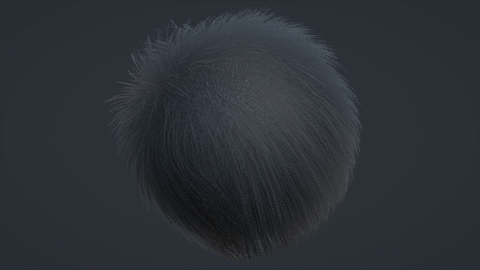
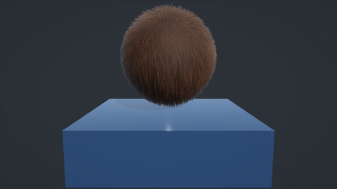
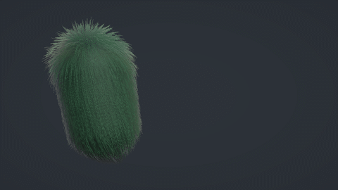
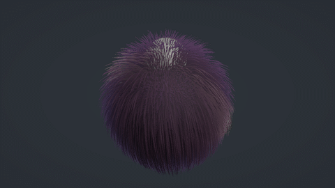
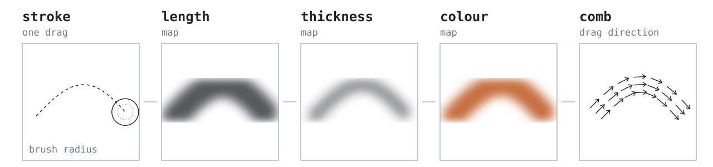
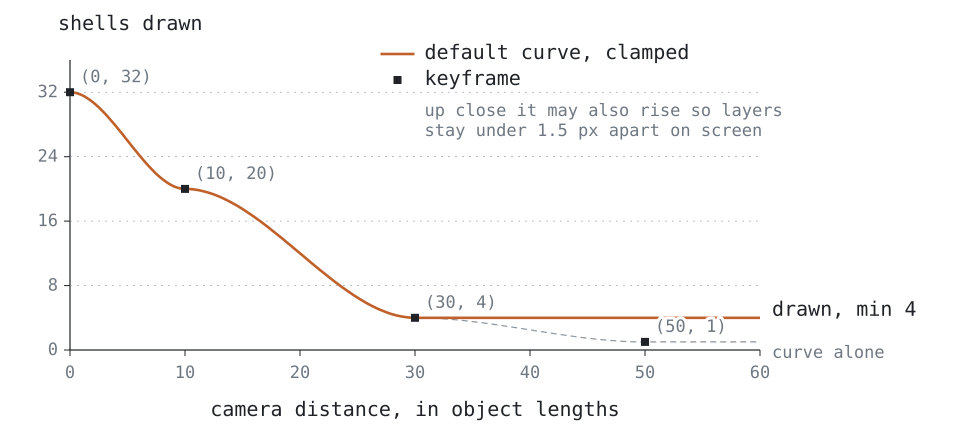

# FURFLUX

Shell and strand fur for Unity URP, with wind, motion inertia, collision, wetness and a brush for
painting the coat in the Scene view.

Unity 6000.3+ · URP 17 · DirectX 11/12, Vulkan, Metal · v1.1.0 · [Manual](Assets/FURFLUX/Documentation/Manual.md) · [Changelog](Assets/FURFLUX/CHANGELOG.md) · [Demo video](Screenshots/8.mp4)

FURFLUX grows fur on any `MeshRenderer` or `SkinnedMeshRenderer`. It does not use geometry or
tessellation shaders: every shell layer, or every batch of hairs, is a GPU instance of one draw.

## Quick start

1. Copy `Assets/FURFLUX` into your project, or open this repository as a Unity project.
2. Select a mesh and choose **GameObject › FURFLUX › Add Fur (Shells)** or **Add Fur (Strands)**.

The object gets a Fur Controller and its own material in `Assets/Fur Materials`, so tuning one
coat never changes another. Fur also renders in Edit Mode. To see every feature in one place, open
**Tools › FURFLUX › Open Showcase Scene** and press Play.

## Shells or strands

The type is one dropdown on the material. Both types share the same physics, so a coat keeps its
shape when you switch.

| | Shells | Strands |
|---|---|---|
| What is drawn | The mesh, repeated outward along its normals; hairs are resolved per pixel | One camera-facing ribbon per hair, skinned on the GPU |
| Cost grows with | Shell count × screen area (overdraw) | Hair count × ribbon segments |
| Good for | Short, dense coats; many creatures on screen | Close-ups, silhouettes, long hair |
| Needs | Normals and UVs | Normals, UVs and **Read/Write Enabled** on the mesh |

<table>
  <tr>
    <td width="50%"> Shells, close up</td>
    <td width="50%"> Strands</td>
  </tr>
</table>

## Dynamics

<table>
  <tr>
    <td width="50%"> Wind</td>
    <td width="50%"> Wetness</td>
  </tr>
  <tr>
    <td width="50%"> Motion inertia</td>
    <td width="50%"> Collision</td>
  </tr>
</table>

- **Wind** lays the coat over in gusts and lets it spring back. The side facing away from the wind
  is sheltered and moves less.
- **Motion inertia** makes fur trail a moving body and overshoot when it stops. Rotation and
  individual bones count, so a tail flick moves the fur on the tail.
- **Collision** pushes hair tips aside around box, sphere and capsule colliders.
- **Wetness** applies only where the coat touches a Fur Water Volume. Wet fur darkens, clumps,
  hangs heavier and dries over time.

Collision and wetness run per vertex, so turn them on only for objects that need them.

## Painting

Click **Draw Fur** on the Fur Controller and paint on the model in the Scene view.

- The brush writes to four channels: length, thickness, colour and comb. One stroke writes every
  channel you have ticked, so the edges line up.
- Comb direction comes from the drag direction.
- **Solid** paints only the visible surface. **Wireframe** paints through the model, which helps
  around collars, ears and tail rings.
- `[` and `]` resize the brush, `I` picks a value, and strokes are undoable.
- **Save Painted Maps** writes the channels out as textures. **Match Mesh Colours** copies the
  colours from the model's own texture.

## Performance

Shell count follows a curve on the Fur Controller. Distance is measured in object lengths rather
than metres, so the same curve works at any import scale. The chart shows the default curve. On
top of it, the count never drops below 4, and up close it is raised if the layers would land more
than 1.5 px apart on screen, which is when a shell coat starts to look like stacked sheets.

Other things that keep the cost down:

- Once strands are smaller than a pixel, distant fur draws their average coverage instead of
  disappearing.
- *Base Layer Only* shadows cost nothing extra. *All Shells* redraws the coat into every cascade.
- *Max Strands* caps the hair count per object for strand fur.
- Objects off screen skip their per-frame work, and painted maps re-bake only when something
  changes.

## Shading

<table>
  <tr>
    <td width="50%"> Anisotropic sheen and backlight scatter</td>
    <td width="50%"> Short, dense coat next to a long one</td>
  </tr>
</table>

The material also has hair colour banding, curl, clumping and an optional fuzz layer that softens
the silhouette. Presets and a script API cover all of it; see the
[manual](Assets/FURFLUX/Documentation/Manual.md).

## Requirements

- Unity **6000.3.21f1** or newer with URP **17.x**
- DirectX 11/12, Vulkan or Metal (Shader Model 4.5, GPU instancing)
- A mesh with normals and UVs. Strand fur also needs **Read/Write Enabled**.
- The screen-space fuzz mode needs the Fur Screen Fuzz renderer feature and MSAA off. The
  geometric fuzz mode has no such requirement.

## Limitations

- Shell fur can show its layers at extreme grazing angles.
- Strand ribbons are flat and lose coverage when seen exactly end-on.
- Shell hair size follows the UV unwrap, so tightly packed islands get finer hairs.
- Motion vectors follow the body, not the sway of individual hairs.
- No lightmap variants. Fur is lit by light probes.
- OpenGL ES and WebGL are not supported.

## License

Free for personal, educational and other non-commercial use. Commercial use is allowed if you
credit the author, for example "Fur rendering powered by FURFLUX". You may not redistribute or
sell FURFLUX itself, modified or not. The full terms are in [LICENSE.txt](LICENSE.txt).
