

  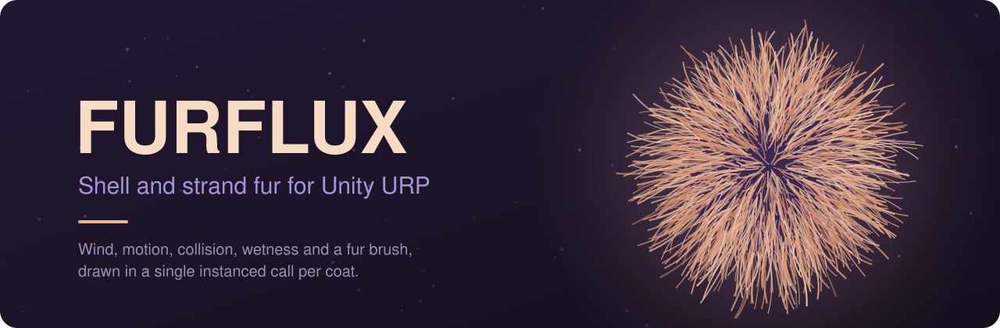

  <b>Unity 6000.3+</b> &nbsp;·&nbsp; <b>URP 17</b> &nbsp;·&nbsp; DirectX 11/12, Vulkan, Metal &nbsp;·&nbsp; v1.1.0
   
  <a href="Screenshots/8.mp4">Watch the demo video</a> &nbsp;·&nbsp;
  <a href="Assets/FURFLUX/Documentation/Manual.md">Read the manual</a>

  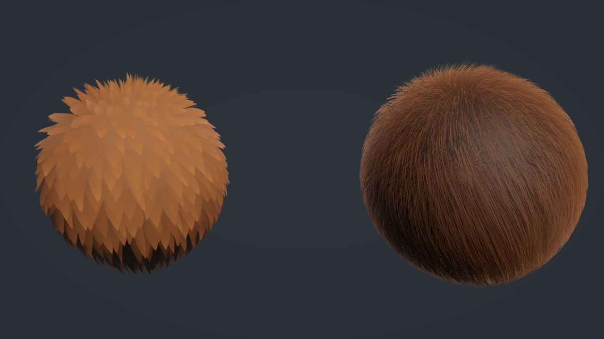

FURFLUX grows fur on any `MeshRenderer` or `SkinnedMeshRenderer`. The coat moves with the body,
leans into the wind, gets wet where it touches water, bends around colliders, and can be painted
directly in the Scene view. No geometry shaders are used: each layer or batch of hairs is a GPU
instance.

## Two kinds of fur

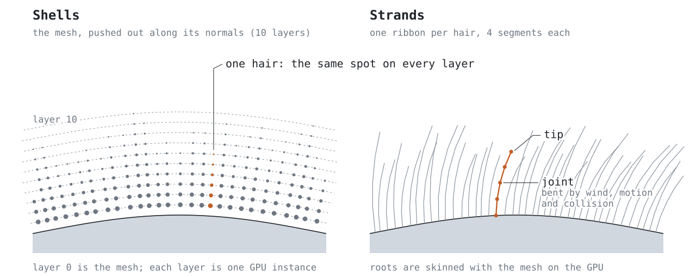

Choose the type from one dropdown on the material. Both types use the same physics, so a coat
keeps its shape when you switch.

- **Shells** are cheap and dense. They suit crowds of creatures and short, velvety coats.
- **Strands** give every hair its own ribbon, skinned on the GPU. They hold up in close-ups and
  on silhouettes, which makes them the choice for hero characters and long hair.

<table>
  <tr>
    <td width="50%">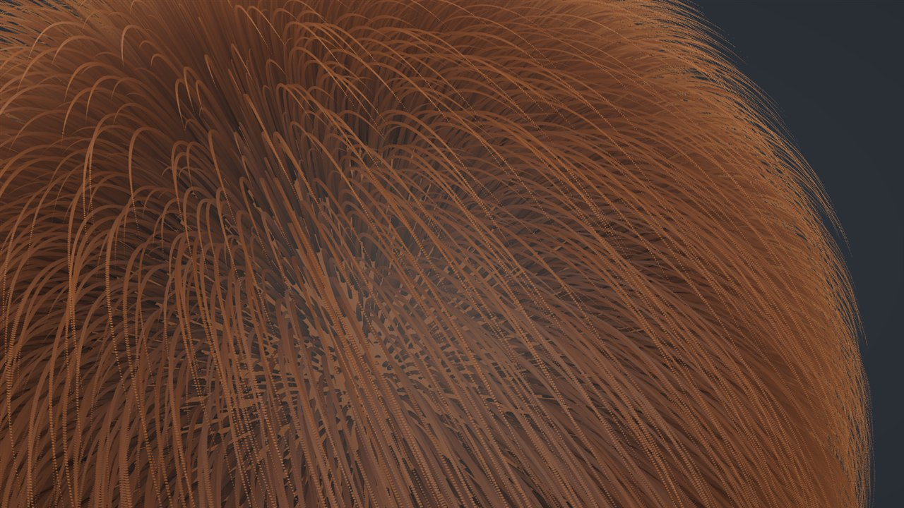 Shells, up close</td>
    <td width="50%">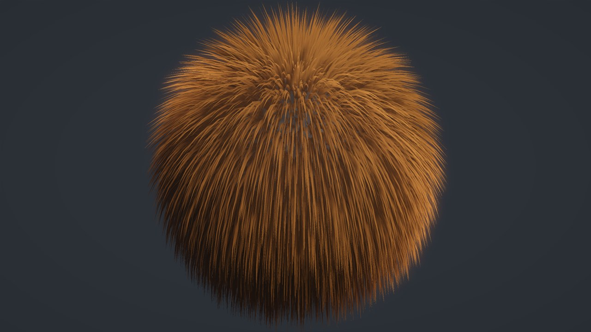 Strands, one ribbon per hair</td>
  </tr>
</table>

## A coat that reacts

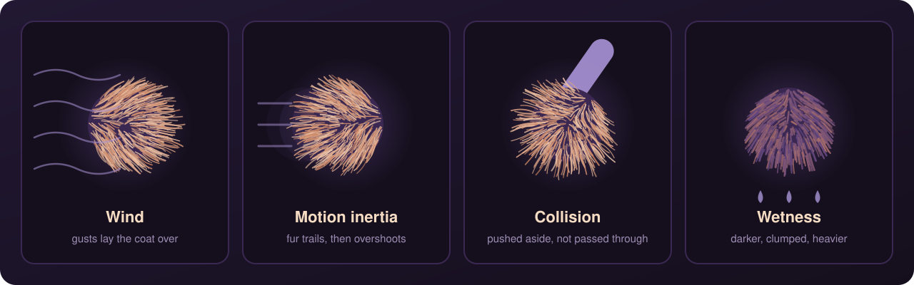

- **Wind.** Gusts lay the coat over and let it spring back. The side facing away from the wind
  is sheltered and moves less.
- **Motion inertia.** Fur trails behind a moving body and overshoots when it stops. Turning and
  individual bones count too, so a tail flick moves the tail's fur.
- **Collision.** Hair tips are pushed aside by box, sphere and capsule colliders instead of
  passing through them.
- **Wetness.** Only the part that touches water gets wet. Wet fur darkens, clumps, hangs heavier
  and slowly dries.

<table>
  <tr>
    <td width="50%">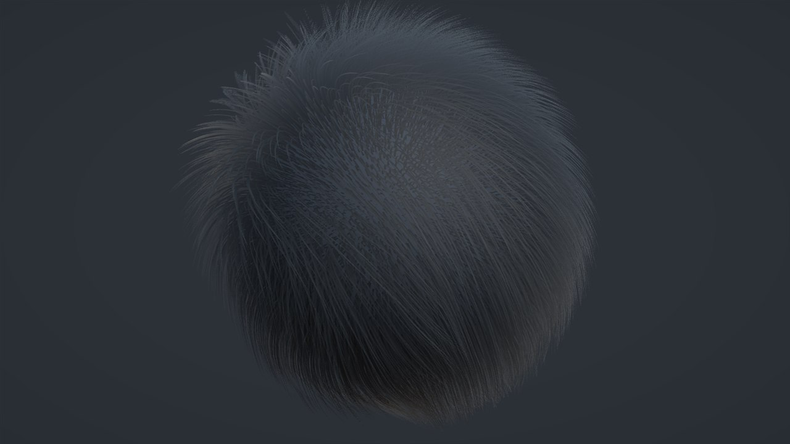</td>
    <td width="50%">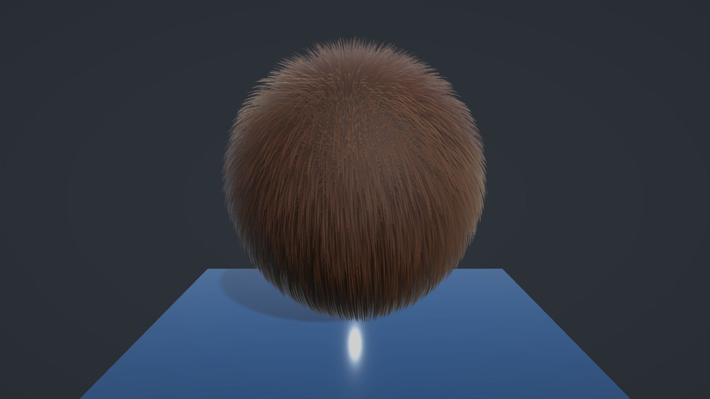</td>
  </tr>
  <tr>
    <td width="50%">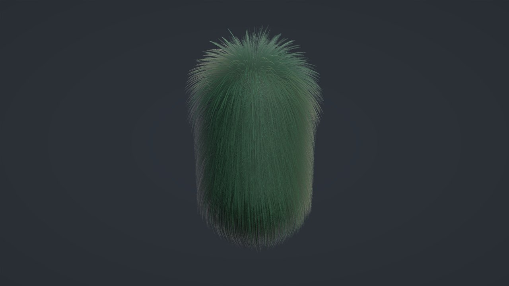</td>
    <td width="50%">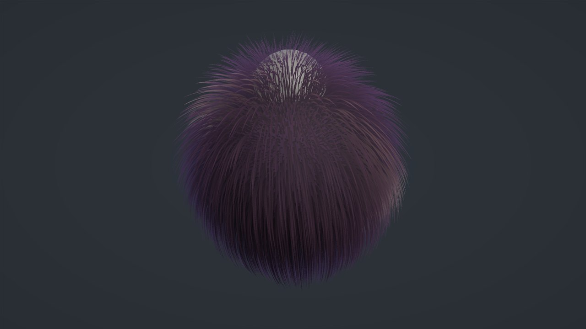</td>
  </tr>
</table>

## Paint it

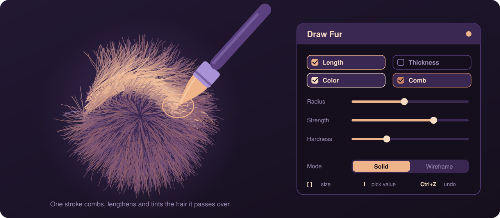

Click **Draw Fur** on the Fur Controller and paint on the model in the Scene view.

- **Four channels:** length, thickness, colour and comb. One stroke writes every channel you
  have ticked, so they share the same edge.
- **Comb** takes its direction from the stroke. Drag across the coat and the hair lies down that
  way.
- **Solid** mode paints only the surface you can see. **Wireframe** mode paints through the model,
  which helps with collars, ears and tail rings.
- Strokes support undo and redo, an eyedropper (`I`) and resizing with `[` and `]`. **Save Painted
  Maps** writes them out as textures.
- **Match Mesh Colours** gives the coat the colours the model's own texture already has.

  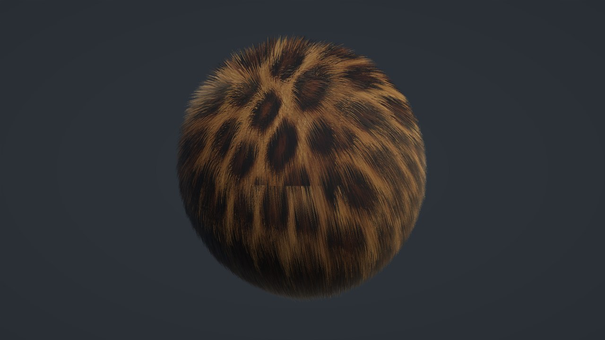

## Built to be fast

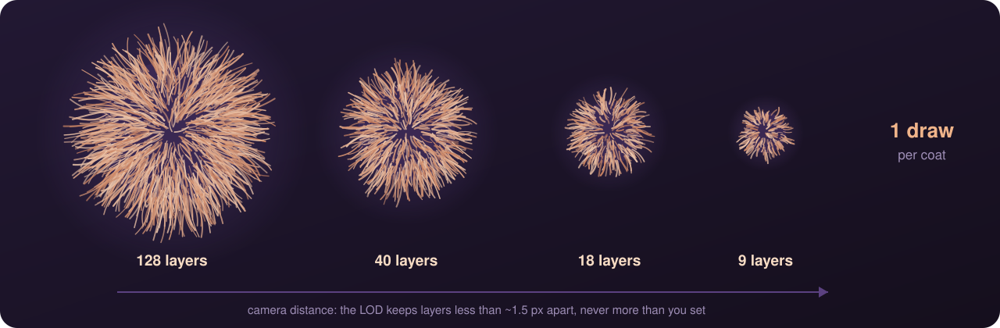

- **One instanced draw per coat.** Every shell layer is an instance of the same draw. There are no
  geometry or tessellation stages.
- **Distance LOD.** Shell count follows a curve measured in object lengths, so it works the same
  at any import scale. The LOD never leaves layers far enough apart to see gaps.
- **Distant fur stays visible.** Once strands are smaller than a pixel, the coat switches to their
  average coverage instead of disappearing.
- **Cheap shadows.** *Base Layer Only* shadows cost nothing extra.
- **Strand budget.** *Max Strands* caps the hair count for strand fur.
- **No idle work.** Objects off screen skip their per-frame work. Painted maps re-bake only when
  something changes.

  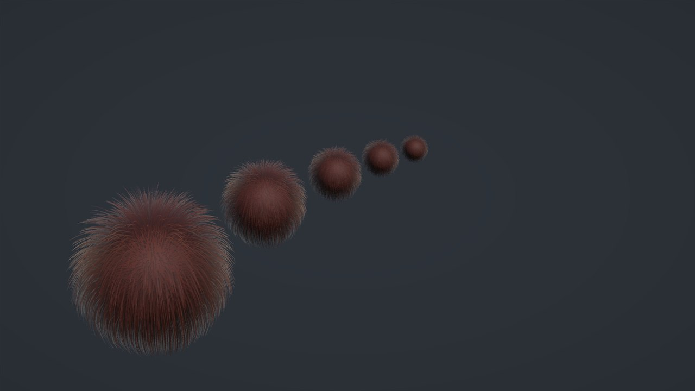

## And the details

<table>
  <tr>
    <td width="50%">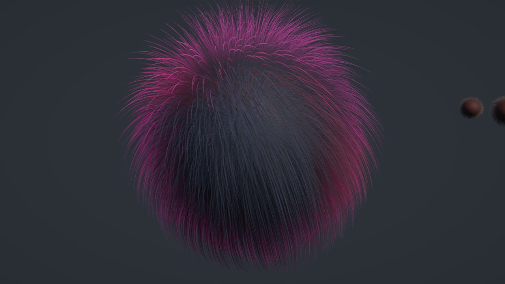 Anisotropic sheen and backlight scatter</td>
    <td width="50%">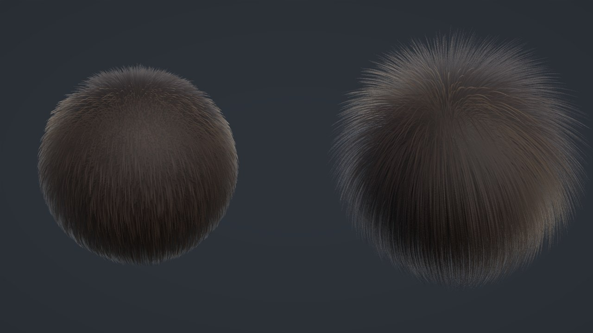 Dense velvet next to a long coat</td>
  </tr>
</table>

Hair colour banding, curl, clumping, a soft fuzz layer for silhouettes, presets, and a script API
for all of it.

## Quick start

1. Select a mesh in your scene.
2. Choose **GameObject › FURFLUX › Add Fur (Shells)** or **Add Fur (Strands)**.
3. That's it. The fur also renders in Edit Mode.

Each object gets its own material in `Assets/Fur Materials`, so tuning it never changes another
object. To see every feature, open **Tools › FURFLUX › Open Showcase Scene** and press Play.

## Requirements

- Unity **6000.3.21f1** or newer, Universal Render Pipeline **17.x**
- DirectX 11/12, Vulkan or Metal (Shader Model 4.5, GPU instancing)
- A mesh with normals and UVs. Strand fur also needs **Read/Write Enabled**.

Mobile (OpenGL ES) and WebGL are not supported.

## Documentation and license

The [manual](Assets/FURFLUX/Documentation/Manual.md) covers every setting, and the
[changelog](Assets/FURFLUX/CHANGELOG.md) lists what changed. See [LICENSE.txt](LICENSE.txt) for
terms.
